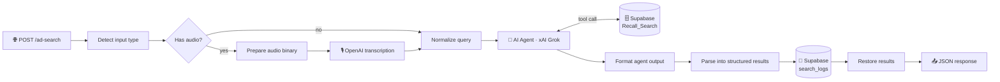

<div align="center">

# 📻 AI-Powered Commercial & Radio Ad Recall Search System

**Type it. Say it. Find the station.** Voice and text search over a radio/TV station directory, powered by an AI query interpreter.

[](https://n8n.io)
[](https://x.ai)
[](https://platform.openai.com/docs/guides/speech-to-text)
[](https://supabase.com)
[](#-api-reference)


*Say "that country station in Texas I used to listen to" and get real call signs, formats, cities, and phone numbers back.*

</div>

---

## ✨ What It Does

A single webhook accepts either a **typed query** or a **voice recording**. Audio is transcribed, an **AI agent** cleans up the request (typos, filler words, speech-recognition errors) and extracts the real search term, then queries a **Supabase** station table. Results come back as structured JSON, and every search is logged.

| Capability | Details |
|---|---|
| 🎙️ **Voice search** | Upload an audio file or send base64 audio; transcribed with `gpt-4o-transcribe` using a radio-specific vocabulary prompt |
| ⌨️ **Text search** | Short queries are used as typed, with only obvious typos fixed |
| 🧠 **Query interpretation** | Grok strips filler ("umm", "can you find…"), fixes ASR errors, and infers genre, city, state, call letters, slogan, or phone |
| 🔎 **Multi-field search** | Matches Format, City, State, Calls, Slogan, and Phone (case-insensitive, partial match, up to 500 rows) |
| 🧹 **Data hygiene** | Drops null values, malformed phones, power ratings mistaken for call signs, and URLs stored in the City field |
| 📦 **Structured output** | Returns clean JSON with a result count, plus parsed fields per station |
| 🧾 **Search analytics** | Logs original query, matched results, source (text or audio), and result count |
| 🚫 **Anti-hallucination** | The agent is told to relay tool output verbatim and never invent stations |

---

## 🏗️ Architecture



---

## 🧰 Tech Stack

| Layer | Technology |
|---|---|
| Orchestration | [n8n](https://n8n.io) |
| LLM agent | xAI Grok (via n8n xAI chat model node) |
| Speech-to-text | OpenAI `gpt-4o-transcribe` |
| Database | Supabase (PostgREST) |
| Interface | HTTP webhook (works with any frontend) |

---

## 📡 API Reference

**Endpoint:** `POST https://<your-n8n-host>/webhook/ad-search`

### Text search

```bash
curl -X POST https://<your-n8n-host>/webhook/ad-search \
  -H "Content-Type: application/json" \
  -d '{"query": "country stations in Texas"}'
```

### Voice search (base64)

```bash
curl -X POST https://<your-n8n-host>/webhook/ad-search \
  -H "Content-Type: application/json" \
  -d '{"audio": "<base64-encoded webm audio>"}'
```

### Voice search (file upload)

```bash
curl -X POST https://<your-n8n-host>/webhook/ad-search \
  -F "file=@recording.webm"
```

### Response

```json
{
  "success": true,
  "query": "country stations in Texas",
  "matched": true,
  "count": 2,
  "results": [
    {
      "raw": "KXXX, Country, Austin, TX, 512-555-0100",
      "calls": "KXXX",
      "format": "Country",
      "city": "Austin",
      "state": "TX",
      "phone": "512-555-0100"
    }
  ]
}
```

*(Sample data is illustrative.)* When nothing matches, the response has `"matched": false`, `"count": 0`, and an empty `results` array.

---

## 🗄️ Database Schema

### `Recall_Search` (your station directory)

Columns used by the workflow: `Calls`, `Format`, `City`, `State`, `Phone`, `Slogan`.

### `search_logs` (analytics)

Columns written by the workflow:

```sql
create table search_logs (
  id bigint generated always as identity primary key,
  created_at timestamptz default now(),
  original_query  text,
  corrected_query text,
  terms           text,
  source          text,     -- 'text' or 'audio'
  result_count    int,
  matched         boolean
);
```

*The column types above are a suggested schema; adjust to your data.*

---

## 🚀 Setup Guide

### 1 · Prerequisites

- n8n (cloud or self-hosted)
- Supabase project with the two tables above
- OpenAI API key (speech-to-text)
- xAI API key (Grok)

### 2 · Import

n8n → **Workflows → Import from File** → select the workflow JSON.

### 3 · Add your keys

The exported file contains **placeholders only**. Replace them as follows:

| Placeholder | Where it appears | What to use |
|---|---|---|
| `put supabase api key` | Log Search node (2 headers) and Search Station Database tool (2 headers) | Supabase **anon** key (with Row Level Security) or a restricted key |
| `put openai api key` | Transcribe Audio node (`Authorization` header) | OpenAI API key |
| `put xai api key` | xAI Grok Chat Model credential | xAI API key |
| Supabase project URL | Log Search node and Search Station Database tool | Your own `https://<project-ref>.supabase.co` |

> 💡 **Best practice:** store keys as n8n credentials instead of typing them into node headers, so they never end up in exported JSON.

### 4 · Activate and test

Activate the workflow and send the `curl` examples above to your production webhook URL.

---

## 🛡️ Production Hardening Checklist

| Item | Why it matters |
|---|---|
| ✅ Add webhook authentication (header token or n8n Header Auth) | The endpoint is public by default, and each call can spend OpenAI and xAI credits |
| ✅ Add rate limiting (reverse proxy or Cloudflare) | Prevents abuse and runaway bills |
| ✅ Sanitize the search term before building the Supabase filter | The term is placed directly into a PostgREST `or=(...)` filter; strip or encode `,` `(` `)` `*` |
| ✅ Enable Row Level Security on both tables | Lets you safely use a low-privilege key |
| ✅ Use n8n credentials for every key | Keeps secrets out of exports and repos |
| ✅ Restrict CORS to your frontend domain | Blocks other sites from calling the API |

---

## 🤝 Contributing

Pull requests are welcome. Please never commit real API keys or project URLs.

## 📄 License

[](LICENSE)

Released under the **MIT License**. You are free to use, modify, and distribute this project. See the [`LICENSE`](LICENSE) file for details.

---

<div align="center">

### 👨‍💻 Built by **Anukul Chandra**

[](https://github.com/Anukul-Chandra)


**If this project helped you, please drop a ⭐. It means a lot!**

</div>
